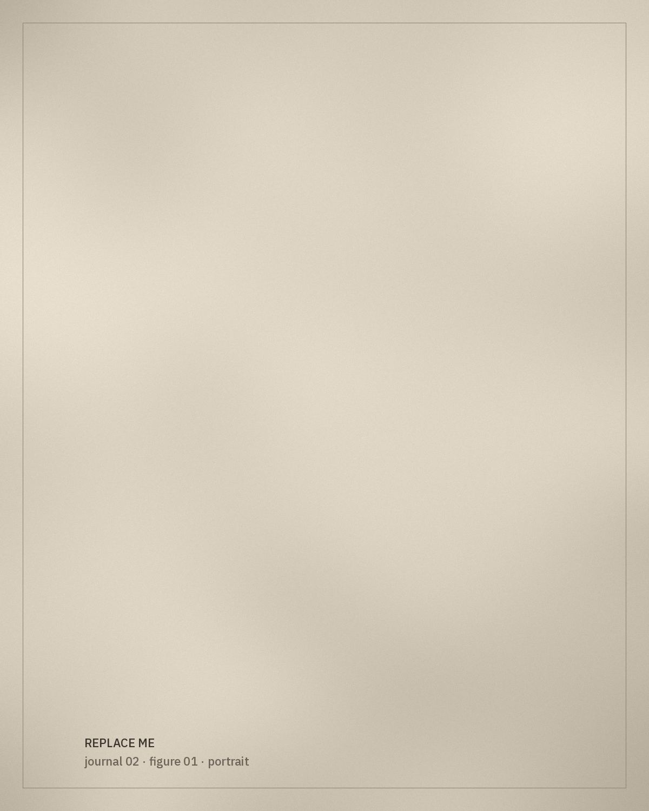

*[Editorial placeholder.]* This article will look at dress in Tlemcen through garments that can be documented: pieces in family hands, photographs with known dates, and the testimony of those who make and wear them.

## Starting from objects

Rather than beginning with general statements, the article will start from specific garments and work outwards, noting what can be established and what remains uncertain.

*[Research to be added.]*

> The most reliable history of a garment often begins with a single photograph and a name written on the back.

## Ceremony and occasion

This section will describe the occasions at which particular garments are worn, based on interviews and documented sources only.

## Notes on method

Every attribution in this article will be referenced. Where something is passed down orally, it will be presented as testimony, with the speaker's consent.
