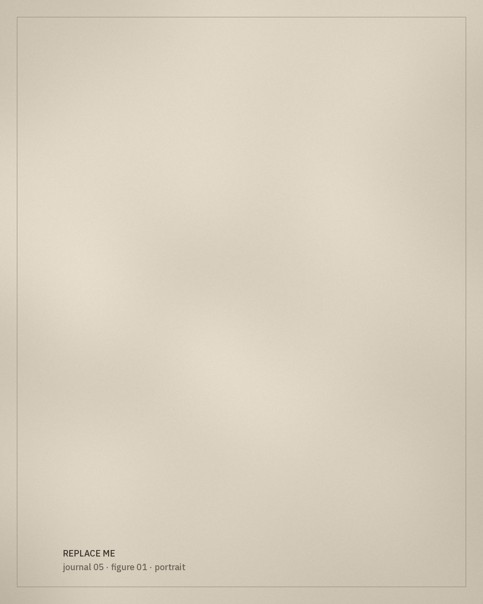

*[Editorial placeholder.]* This essay will reflect on contemporary creation within the project: how new pieces draw on archival garments, and how to do that with care, credit and context.

## Reinterpretation, not reproduction

A section on the difference between copying a historical garment and responding to it.

> To make something new from an old form is also to say what we have understood of it.

## Credit and context

*[To be written: how makers, artisans and sources are credited in the project.]*

