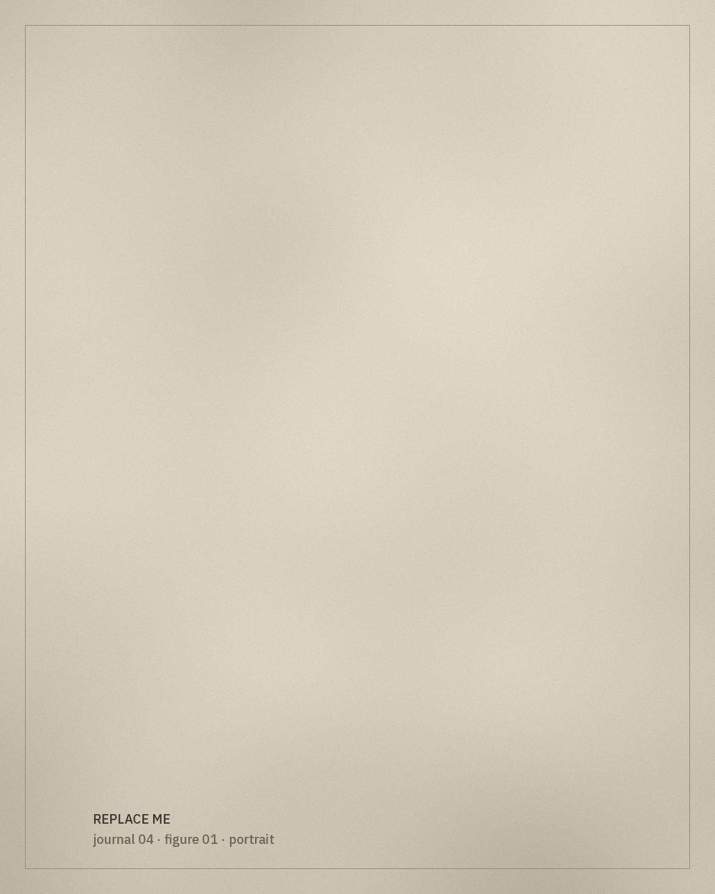

*[Editorial placeholder.]* This article will set out how pieces in the Shera Creates archive are examined and recorded, so that readers can follow — and question — the way each entry is built.

## The checklist

For every garment, the archive aims to record:

- the full garment, front and back;
- embroidery and textile details, with scale;
- cuffs, neckline, buttons and fastenings;
- lining and interior construction;
- repairs, alterations and signs of wear;
- measurements and condition.

> A garment can be read as an archive.

## Repairs and alterations

Alterations are part of a garment's history, not damage to be hidden. This section will explain how they are photographed and described.

## What stays uncertain

Each entry distinguishes between what is observed, what is reported and what is still unknown.
