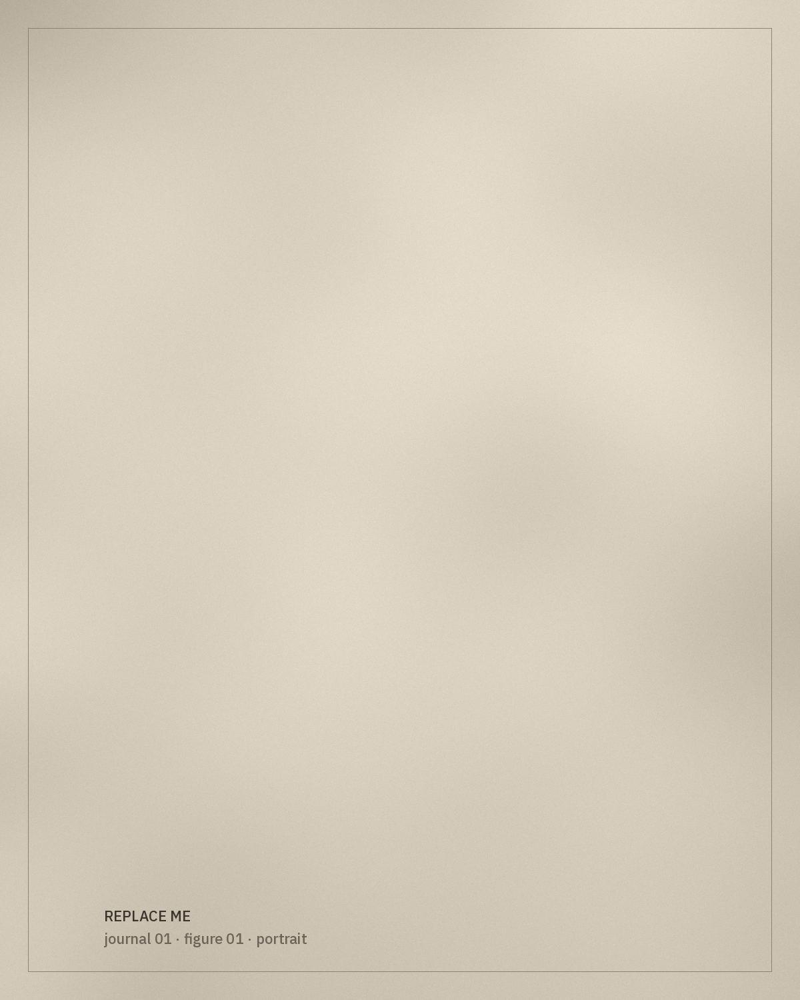

---
# Editorial placeholder — replace the text and images, then set
# `placeholder: false`.
title: "The Algerian Kaftan: A Living Garment"
subtitle: "Notes towards a history of a garment that is still worn, made and remade."
date: 2026-09-12
cover: ./replace-me-journal-01-cover.jpg
coverAlt: "Placeholder image — to be replaced with a photograph for this essay."
coverCaption: "Placeholder photograph. Caption to include the garment, collection and photographer."
excerpt: "An opening essay for the journal: why look at the Algerian kaftan as a living garment rather than a fixed costume?"
references: []
placeholder: true
---

*[Editorial placeholder.]* This opening essay will introduce the journal's approach: treating the kaftan not as a fixed costume but as a garment that continues to be worn, adapted, inherited and made anew.

## A garment with many histories

The kaftan has a long history shared across many regions and periods. This section will situate the Algerian kaftan within that wider history carefully, citing sources for each claim and avoiding simplified national narratives.

*[Research to be added: published scholarship, museum collections and oral testimony.]*

> A garment is never only an object. It is also the people who made it, wore it and kept it.

## Continuity and change

This section will consider how cuts, materials and decoration change over time while something recognisable remains — and who decides what counts as "traditional".

## Questions for this essay

- How is the garment described by those who wear it today?
- Which words are used in Algerian Arabic, Tamazight and French, and by whom?
- What do family collections reveal that museum collections do not?
