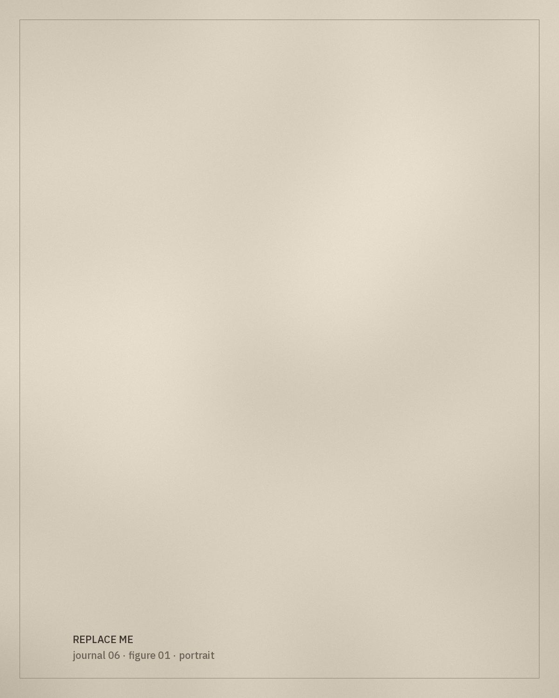

*[Editorial placeholder.]* This article will begin a glossary of embroidery techniques and motifs, gathering the words used by makers and wearers alongside their sources.

## Words and their sources

Each term will be given with its language, its spelling variants and the source in which it was recorded. Terms will only be added once they have been verified.

*[Glossary entries to be added.]*

> Naming a stitch correctly is a way of honouring the person who taught it.

## Motifs

This section will describe recurring motifs visually first, and interpret them only where documented sources allow.

