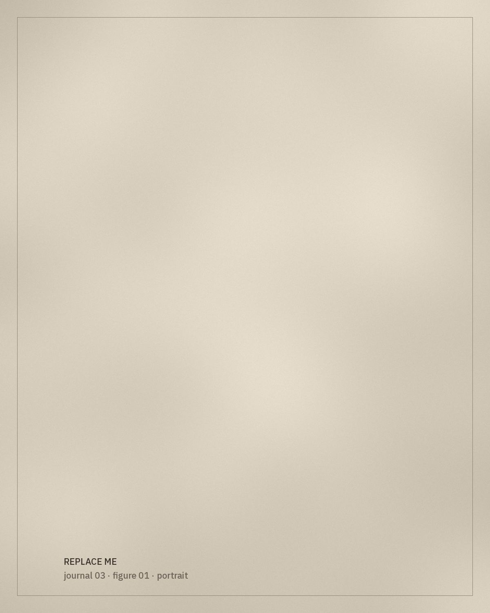

*[Editorial placeholder.]* This essay will look at the materials most often associated with ceremonial kaftans — velvet, brocade and metallic thread — and ask what they reveal about making, trade and occasion.

## Looking at surfaces

A section on how materials are identified by eye and by hand, and why identification should be confirmed by examination rather than assumed from photographs.

> Gold thread catches the light, but it also records the hand that laid it down.

## Thread and weight

*[Research to be added: how metallic threads are made and applied, with references to technical literature.]*

## Ceremony

This section will connect materials to occasions only where sources allow it.
